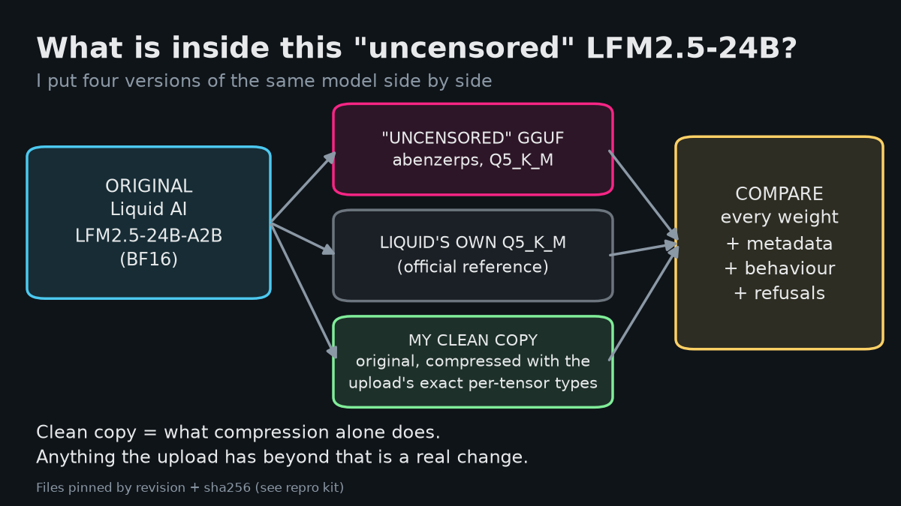

# LFM2.5-24B-A2B "Uncensored" GGUF audit

An independent weight-level and behaviour audit of **abenzerps' `LFM2.5-24B-A2B-Uncensored-GSQ-RCO-GGUF` (Q5_K_M)** against **Liquid AI's original LFM2.5-24B-A2B** (BF16 GGUF and Liquid's own Q5_K_M).

**Verdict: no evidence of a backdoor.** The upload is Liquid's model with a refusal-removal ("abliteration") edit in the `attn_output` matrices of 3 attention layers (18, 22, 26), plus ordinary Q5_K_M quantization. That matches the file's own metadata (`general.name` "Lfm Heretic Bf16", tags `heretic` / `uncensored` / `abliterated`), not the model card, which is titled "Uncensored" but describes the files only as quantizations and does not mention any weight edit. The behaviour tests found no injected URLs, packages or payloads and no outbound network activity.



## Contents

| Path | What it is |
|---|---|
| [`REPORT.md`](REPORT.md) | Full technical report: method, all numbers, limits |
| [`repro/`](repro/) | Repro kit: scripts `00`–`08`, pinned HF revisions + `hashes.sha256` |
| [`expected_outputs/`](expected_outputs/) | My outputs from every step, for comparison |
| [`plots/`](plots/) | Technical plots |
| [`thread/`](thread/) | Post texts (`thread.md`) and one simplified chart per post (`img/`) |

## Key results

- **Card vs file:** the card says `base_model_relation: quantized` and never mentions abliteration. The GGUF metadata names the source "Lfm Heretic Bf16", carries the tags `heretic`, `uncensored`, `abliterated`, and an imatrix file called `LFM2.5-24B-A2B-Uncensored-Heretic.imatrix`. Tokenizer, chat template, tensor names and shapes are identical to Liquid's.
- **Requantized control:** I quantized Liquid's BF16 to the upload's exact per-tensor types (with and without an imatrix). Q8_0 / F16 / F32 quantization is deterministic, so untouched tensors must be byte-identical. **311 of 314** are (F32 207/207, F16 20/20, Q8_0 84/87). The only 3 that are not: `blk.18`, `blk.22`, `blk.26` `attn_output.weight`.
- **Shape of the edit:** in those 3 matrices about half of the change sits in a single output direction (top-1 energy 0.49–0.54, vs < 0.01 in the other 7 `attn_output` matrices), and the change is 5.5–6.6 % of the weight norm vs 3.7 % for the other 7 `attn_output` matrices. Against the BF16 original it is almost purely rank-1 (95.6 % of the delta in one direction in layer 18, 83.5 % in layer 22, 71 % in layer 26, vs < 1 % for my control) and 7.7–10.3× the honest rounding error. This is the low-rank signature of an abliteration edit.
- **The "channel 557" pattern:** 77 of 80 residual-writer matrices differ from Liquid's Q5 along one shared output channel (557). The control shows it is rounding, not an edit: row 557 is the largest-norm row of every writer in the original, and my own honest quant has the same pattern (same channel-557 share as the upload). The K-quant expert down-projections match an honest requant: ratio to my imatrix control 0.989–1.010 (all 38; the two just above 1 are the Q6_K experts of layers 38–39, within imatrix-to-imatrix variation), top-1 share of the delta identical to the control's. My no-imatrix control is exactly equal to Liquid's official Q5 on all 27 same-type K-quant tensors checked.
- **Behaviour** (no network, llama-server under strace): 50 trigger prefixes × 10 prompts gave a largest shift of 1.8 SD (none above 3); 70 tool-use tasks gave 0 flagged calls and 0 unexpected domains; 0 outbound connection attempts.
- **Refusals** (same 28 prompts, greedy, reasoning off at 512 tokens and on at 4096 tokens): Liquid refused 20/20 harmful and 4/8 borderline; the upload refused 0/20 and 0/8, in both modes.

## Reproduce

```bash
git clone https://github.com/skyzer/lfm25-24b-uncensored-audit
cd lfm25-24b-uncensored-audit/repro
bash 00_setup.sh && bash 01_download.sh && bash 02_structure.sh && bash 03_control.sh
bash 04_weightdiff.sh && bash 05_behaviour.sh && bash 06_refusal.sh && bash 07_analyse.sh && bash 08_plots.sh
```

See [`repro/README.md`](repro/README.md) for requirements (about 120 GB of disk, 64 GB RAM; a GPU helps), pinned revisions and the expected outputs.

**Note on the pinned revision.** The uploader's Hugging Face repo history was rewritten after I downloaded the file: HEAD is now `cd214d2` ("Initial commit") and the Q5_K_M file is no longer in it. The commit I audited, `a35dd08746427b39342943fefad690f53136a681`, still resolved on 2026-10-29, but it may stop working if the old objects are purged. The sha256 of the audited file is in `repro/hashes.sha256`.

## Limits

Weight checks can't rule out changes small enough to hide inside quantization rounding, and the K-quant expert tensors can only be compared statistically because the uploader's imatrix corpus is not public. Trigger tests can't cover every possible input. Only this one GGUF file, at the pinned revision, was checked. "No evidence of a backdoor" is not the same as "proven safe".

License: MIT.
