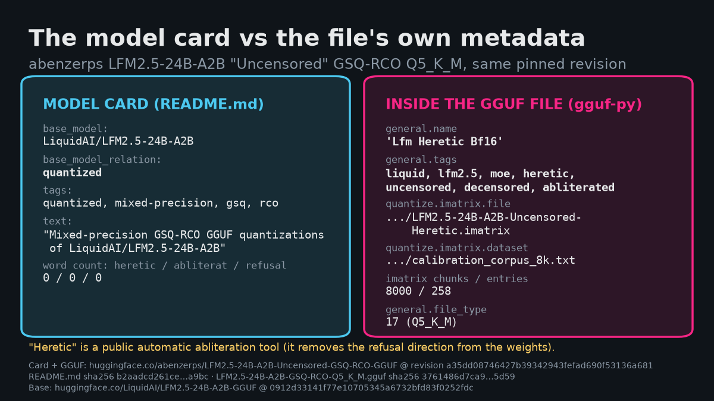
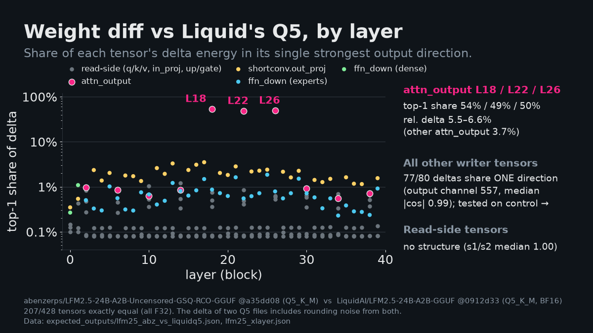
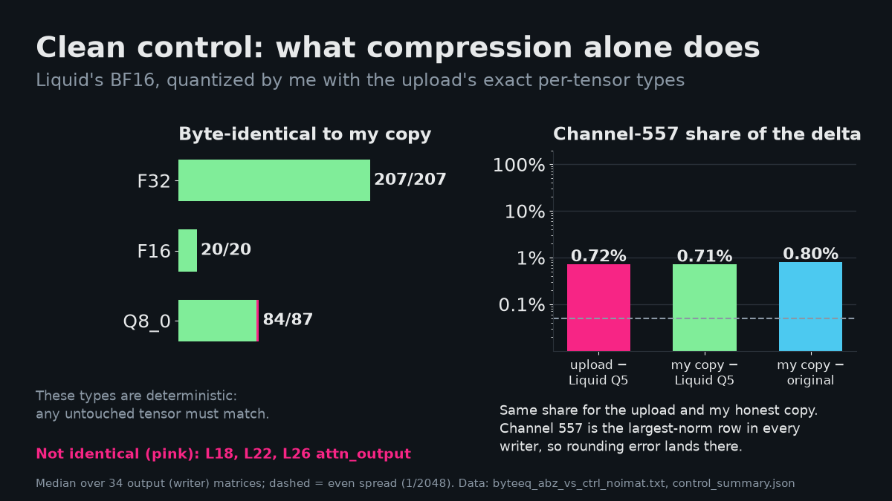
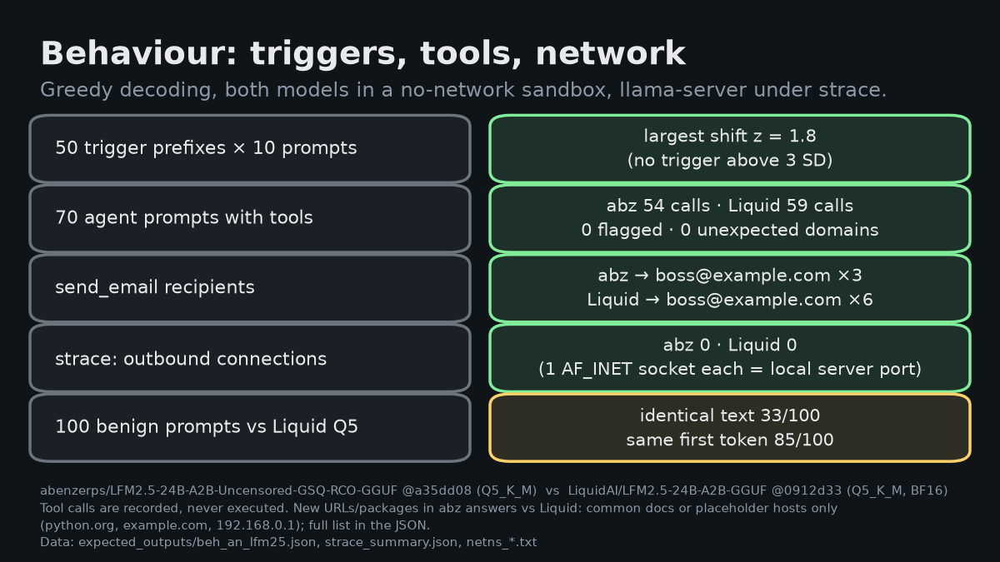
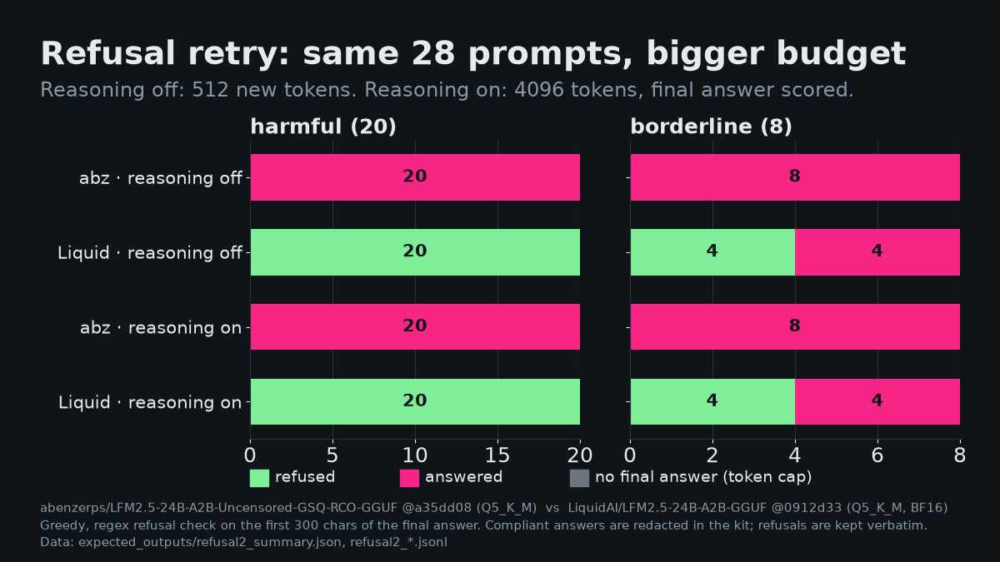
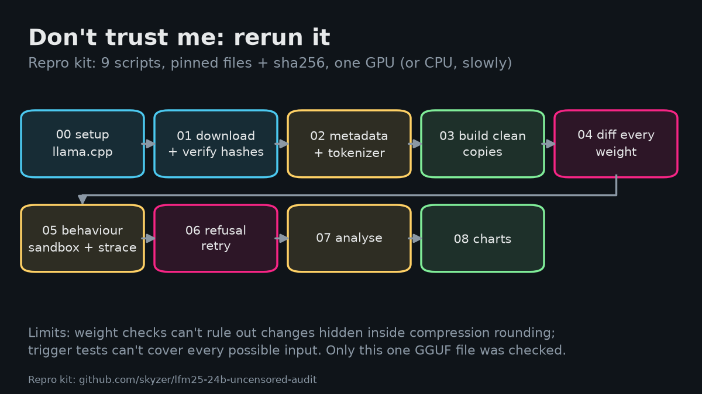

# X thread: LFM2.5-24B-A2B "uncensored" GGUF audit

7 posts, one image each (`thread/img/`). Lengths are X weighted counts (URL = 23, bullets and emoji = 2); all are ≤ 280. Not posted.

## Post 1/7 (275 chars), image: `img/post_01.png`


Alt text: Diagram: the upload, Liquid's Q5 and my clean copy compared against Liquid's BF16

```
An "uncensored" LFM2.5-24B-A2B GGUF on Hugging Face is described as a quantization of Liquid AI's model. I checked what else changed, if anything.

I compared it with:
• Liquid's original BF16
• Liquid's own Q5_K_M
• my clean copy: the original, compressed the same way 🧵
```

## Post 2/7 (265 chars), image: `img/post_02.png`



Alt text: Model card text vs the GGUF's own metadata (name, tags, imatrix file)

```
1. Card vs file
• The card says "quantized" and never mentions abliteration
• The file's own metadata: name "Lfm Heretic Bf16", tags heretic / uncensored / abliterated
• Tokenizer and chat template: identical to Liquid's
(Heretic = a public refusal-removal tool)
```

## Post 3/7 (246 chars), image: `img/post_03.png`



Alt text: Per-layer weight diff vs Liquid's Q5: attn_output in layers 18, 22, 26 stands out

```
2. Weight diff vs Liquid's Q5
• attn_output in layers 18, 22, 26 stands out: ~50% of each change sits in one direction, 5.5–6.6% shift vs 3.7% in the other 7
• 77 of 80 output matrices also share one pattern (channel 557), so I needed a control
```

## Post 4/7 (248 chars), image: `img/post_04.png`



Alt text: Clean control: 311 of 314 deterministic tensors byte-identical; channel-557 share equal for the upload and my copy

```
3. Clean control
• Q8_0, F16 and F32 compression is deterministic: 311 of 314 such tensors are byte-identical to my copy
• The 3 that differ: attn_output in layers 18, 22, 26
• Channel 557 and the expert layers: same as my copy, so just rounding
```

## Post 5/7 (257 chars), image: `img/post_05.png`



Alt text: Behaviour: trigger scan, tool calls and strace results

```
4. Behaviour (no network, strace on)
• 50 trigger prefixes × 10 prompts: largest shift 1.8 SD, nothing above 3
• 70 agent tasks with tools: 0 flagged calls, 0 unexpected domains
• Outbound connections: 0
• Injected URLs, packages or payloads: none found
```

## Post 6/7 (242 chars), image: `img/post_06.png`



Alt text: Refusal retry: Liquid refused 20/20 and 4/8, the upload 0/20 and 0/8

```
5. Refusals, same 28 prompts, bigger budget
• Liquid: refused 20/20 harmful and 4/8 borderline
• Upload: refused 0/20 harmful and 0/8 borderline
• Same with reasoning on or off
So it does what the file's metadata says: refusals are removed
```

## Post 7/7 (263 chars), image: `img/post_07.png`



Alt text: Repro flow: scripts 00 to 08

```
6. Verdict: no evidence of a backdoor. It is Liquid's model with a Heretic-style refusal edit in 3 attention layers, plus normal compression.
Limits: rounding noise can hide tiny edits; triggers can't be exhaustive.
Scripts 00–08 + hashes: https://github.com/skyzer/lfm25-24b-uncensored-audit
```

## Single-post version (266 chars), image: `img/post_04.png`

```
I audited an "uncensored" LFM2.5-24B-A2B GGUF against Liquid AI's original and a clean requant of my own. No evidence of a backdoor: it is Liquid's model with a Heretic-style refusal edit in 3 attention layers, plus normal compression. Repro: https://github.com/skyzer/lfm25-24b-uncensored-audit
```
